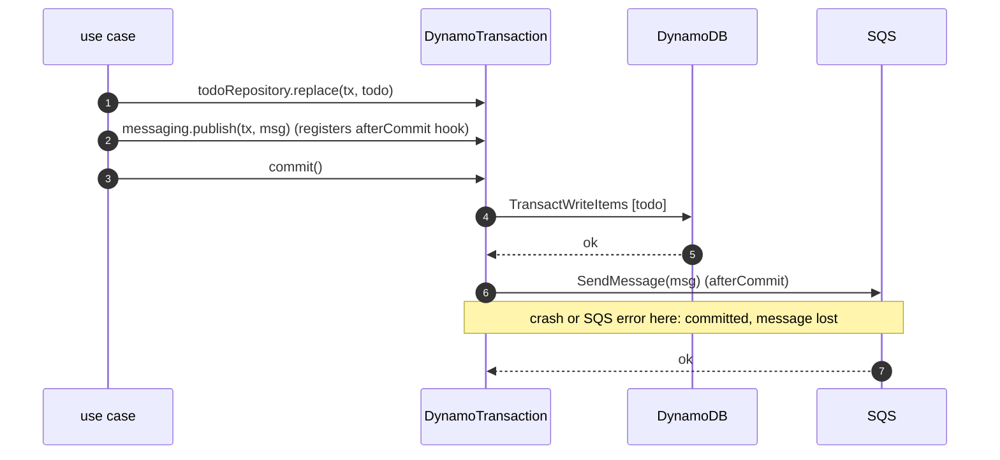
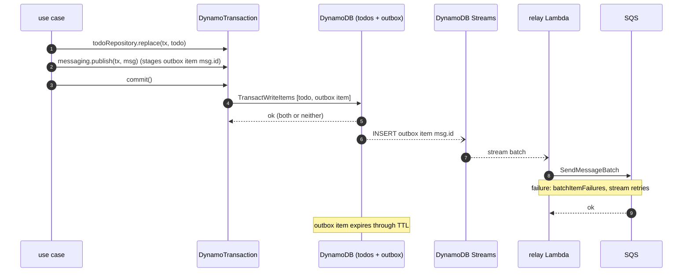

# openapi-fastify

Demo monorepo: Fastify API with an OpenAPI spec generated from Zod schemas, a typed API client
generated from that spec, and business logic in a shared package wired through a type-safe
dependency container. The server and an SQS Lambda both consume that package.

```
packages/common      business logic, no HTTP: domain/, repositories/ (ports), integrations/ (DynamoDB), features/ (use cases), container
packages/api-client  @hey-api/openapi-ts fetch client generated from apps/server/openapi.json, request-ID helpers
apps/server          Fastify 5 + fastify-type-provider-zod + @fastify/swagger, pino with request IDs
apps/cli             Stricli CLI over @demo/api-client
apps/lambda          SQS-triggered Lambda that creates todos through @demo/common
```

## Getting started

```sh
mise install            # node + pnpm versions from mise.toml
pnpm install
cp .env.example .env
pnpm dev                # DynamoDB Local on :8000 + todos table + API on :3000 (watch), Swagger UI on /docs

pnpm -s cli todos add "Buy milk"
pnpm -s cli todos list
pnpm -s cli todos update <id> --done -v --request-id my-trace
pnpm -s cli projects create Garden -t "Mow lawn" -t "Plant tulips"
pnpm lambda:invoke "Water plants"   # runs the Lambda handler locally with a fake SQS batch
pnpm check              # format check + lint + typecheck + layering rules
pnpm fmt                # format everything with oxfmt
```

`pnpm dev` is `db:up` → `db:init` (waits for DynamoDB) → `dev:server`; run the steps
individually if you prefer. All TypeScript runs directly on Node (type stripping), so there is no build step.

## How it fits together

**Schemas → OpenAPI → client.** Zod schemas in `packages/common/src/domain/` (entities) and
`features/*/…schema.ts` (use-case inputs and views) validate requests in Fastify and become OpenAPI components via `.meta({ id })`. After changing
schemas or routes, run:

```sh
pnpm generate   # writes apps/server/openapi.json, then regenerates packages/api-client/src/client
```

**Container.** `createContainer({ config, logger })` in `packages/common/src/container.ts` builds
the process-wide infrastructure once: config, context logger, DynamoDB client, repositories and the
`beginTransaction`. Use cases are not in it (see [Use cases](#use-cases)). Modules compose with
`extend()`, and each module's parameter type is checked against what is already provided.

**Request-scoped logging.** The server derives a request ID from the `x-request-id` header,
or generates a UUID, and echoes it back. Its `onRequest` hook continues the request inside
`runWithContext({ logger: request.log }, …)` (AsyncLocalStorage, `packages/common/src/context.ts`).
Repositories and use cases log through a context logger that writes through the current context's
logger. Every log line from common code therefore carries `requestId`, even though the
repositories are singletons. Outside a
context (startup, scripts), it falls back to the root logger. Other entry points, such as a queue
worker, call `runWithContext` the same way, as `apps/lambda` does (see Lambda below). The CLI
sends a fresh UUID (or `--request-id`) and
prints it on errors, so you can grep the server logs for it. Why ALS is used for logging but not for
transactions: [AsyncLocalStorage: for logging, not for transactions](#asynclocalstorage-for-logging-not-for-transactions).

**CLI.** Stricli has no global flags, so every API command spreads `apiFlags` (`--api-url`,
`--request-id`, `-v`) from `apps/cli/src/context.ts` into its own flags. They go after the
subcommand: `demo todos list -v`. Commands run their API calls through `withApi(flags, …)`, which
returns `ApiRequestError`s to Stricli so it prints just the message, e.g.
`Could not reach http://localhost:3000: ECONNREFUSED (request …)`.

**Lambda.** Every handler in `apps/lambda` is wrapped with `lambdaHandler()` (`src/lambda.ts`).
On the first invocation in a sandbox it builds config, the Lambda's own pino logger (`src/logger.ts`)
and the container, and reuses them while the sandbox stays warm. Each invocation runs inside
`runWithContext` with a child logger bound to `requestId` (the Lambda request ID) and
`aws: { accountId, region, functionName, functionVersion, traceId }`, with the account and region
taken from `invokedFunctionArn`. Common code logs through the container's context logger, so every
line it writes carries those AWS fields without knowing it runs in Lambda. The wrapper also
logs invocation start (with `coldStart`), duration and failures. A handler gets
`{ container, logger, context }`.

`sqsHandler(schema, handle)` (`src/sqs.ts`) builds on it for SQS: it parses each record's body with
`schema` and runs `handle` per record in a nested context that adds
`sqs: { messageId, queue, receiveCount }`, so common's log lines also say which message they belong
to. Malformed bodies and `AppError`s are logged and dropped; other failures go to
`batchItemFailures` so SQS retries only those records (on a FIFO queue, also every record after the
first failure). A consumer is then just the use-case call:

```ts
// handlers/createTodos.ts
export const handler = sqsHandler(CreateTodoInputSchema, async (input, { container }) => {
  await createTodo(container, input);
});
```

**Config.** `CommonConfigSchema` covers what common needs (AWS, tables). Each app extends it
with its own sections (`ServerConfigSchema`, `LambdaConfigSchema`) and passes the whole object into the container,
whose type parameter keeps the extended config typed on `container.config`.

## Layers

```
packages/common/src/
  domain/              ids.ts, todo.ts, project.ts: branded entities + rules (newTodo, applyTodoUpdate, newProject, withTodos)
  repositories/        ports: what use cases depend on (interfaces only)
    todo.repository.ts, project.repository.ts
    transaction.ts     Transaction (afterCommit, rollbackOnly) and RootTransaction (+ commit)
  integrations/        adapters: one directory per external system
    dynamo/
      client.ts        DynamoClient: send() for reads, writeAtomically() (failed condition → the writer's error)
      transaction.ts   DynamoTransaction: stages writes, commits them in one call
      write.ts         Write / WriteOp: storage ops built by tables/
      tables/          storage format per table: definition, key, item mapping, write ops (no I/O)
      *.repository.ts  implement the ports; reads run immediately, writes stage into the transaction
  container.ts         infrastructure only: config, logger, dynamo, repositories, beginTransaction
  features/
    use-case.ts        useCase() helper
    transaction.ts     useTransaction(): declares a use case transactional
    todos/, projects/  one use case per file
```

This is ports and adapters (hexagonal architecture). Use cases depend on the interfaces in
`repositories/`. `integrations/` implements them, one directory per external system, and the container
wires them together. Another backend, for example a repository backed by an HTTP API in
`integrations/http/`, implements the same port without any change to the use cases. One caveat: an HTTP
API has no transactions. Its write methods would not take `tx`, and would run immediately or from
`afterCommit`. The missing `tx` parameter makes visible that the write is not atomic.

**Public API.** Apps import only `@demo/common`, and `package.json` `exports` blocks deep imports.
`src/index.ts` names what that includes: config, `createContainer`, `runWithContext`, errors, entity and
input schemas, and each feature's use cases and schemas (from the feature's `index.ts`). Domain rule
functions, ports, `useCase`/`useTransaction`, `Deps` types and the DynamoDB integration stay
internal, so an app cannot bypass a use case or write to DynamoDB directly.

Imports point one way, `features → repositories ← integrations`, with `container` wiring them together and
`domain` innermost. `pnpm lint:deps` (dependency-cruiser, `.dependency-cruiser.cjs`) enforces it:

| Rule                                                                       | Why                                                                                                                                                            |
| -------------------------------------------------------------------------- | -------------------------------------------------------------------------------------------------------------------------------------------------------------- |
| `no-circular`                                                              | Use cases may call use cases in other features, but the graph must stay acyclic.                                                                               |
| `no-cross-feature-barrels`                                                 | Import `../todos/createTodo.ts`, not `../todos/index.ts`. A barrel drags in the whole feature, which turns an acyclic graph of use cases into cyclic features. |
| `features-without-container`                                               | Use cases name ports in their `Deps`, never `Pick<Container, …>`, so they cannot ask for the DynamoDB client or anything else the container holds.             |
| `features-use-ports`                                                       | Use cases import ports, never `integrations/`. Storage ops, clients and tables stay behind the port, so a use case cannot stage raw DynamoDB writes.           |
| `ports-are-abstract`                                                       | `repositories/` depends on nothing but `domain/`.                                                                                                              |
| `integrations-independent`                                                 | Each integration stands alone; the container combines them.                                                                                                    |
| `repositories-independent`                                                 | Repository implementations never use each other; atomicity comes from the use case's transaction.                                                              |
| `container-is-infrastructure`                                              | The container, ports and integrations never import use cases.                                                                                                  |
| `tables-without-io`, `domain-is-innermost`, `integrations-below-container` | Keep the direction one-way.                                                                                                                                    |

## Use cases

A use case is a plain function `(ctx, ...args)` defined with `useCase()`. Its `ctx` type names the ports
it needs, not keys of the container, and apps pass the container directly. It matches by shape:

```ts
// features/projects/createProject.ts
export type CreateProjectDeps = CreateTodoDeps & { projectRepository: ProjectRepository };

export const createProject = useCase(
  'createProject',
  useTransaction(async (ctx: Transactional<CreateProjectDeps>, input: CreateProjectInput) => {
    const project = newProject(input, now);
    const todos = await Promise.all(input.todos.map((t) => createTodo(ctx, t, { projectId: project.id })));
    ctx.projectRepository.create(
      ctx.tx,
      withTodos(
        project,
        todos.map((t) => t.id),
        now,
      ),
    );
    ctx.tx.afterCommit(() => ctx.logger.info({ id: project.id }, 'project created'));
    return toProjectDetails(project, todos);
  }),
);

// apps/server
(request) => createProject(container, request.body);
```

**Transactions are business logic.** Which writes must succeed together is a use case's decision, so
a use case that writes is declared with `useTransaction()` (`features/transaction.ts`), and its body
gets `ctx: Transactional<Deps>`, which carries `ctx.tx`. Repositories only translate between the domain
and DynamoDB. Their write methods take `ctx.tx` and stage into it, and they never open, join or
commit a transaction. A read-only use case (`getTodo`, `listTodos`, `getProject`) has no `ctx.tx`, so a
write there does not compile. Nothing in `integrations/` can be imported into `features/`
(`features-use-ports`), so writes always go through a repository. Why this
design, its caveats, and the alternatives: [Transactions: design options](#transactions-design-options).

**Composition.** A transactional use case called with a `ctx` that already carries `tx` joins that
transaction, and only the outermost one commits. So `createProject` → `createTodo` ×N is one
transaction, and so is `deleteTodo` → `detachTodoFromProject`. If a joined use case throws, the
transaction becomes rollback-only. A caller that catches the error still cannot commit the callee's
half-staged writes; its commit fails instead. A non-transactional use case that calls two
transactional ones makes two separate commits.

**Dependencies are type-checked.** A caller's deps must include its callees' deps
(`CreateProjectDeps = CreateTodoDeps & …`). Dropping `todoRepository` from it fails to compile.

**Why one file per use case.** A `todoService` object bundles every todo use case, so each one
inherits the dependencies of all the others. `projects → todos` (for create) plus
`todos → projects` (for delete cleanup) is then a cycle, even though no single use case depends on
itself. With one file per use case, the graph is just `createProject → createTodo` and
`deleteTodo → detachTodoFromProject`.

**Rules of transactions** (DynamoDB transactions are write batches, not interactive):

- Staged writes are invisible to reads in the same use case. Express preconditions as conditions
  (`attribute_exists`, `updatedAt = :expected`, `todoIds[i] = :id`), not read-then-check alone.
- Writes return nothing. Return the domain object you built (`withTodos(project, …)`), or re-read.
- At most one write per item and 100 writes per transaction; staging throws early otherwise.
- Side effects (logs, events) go in `ctx.tx.afterCommit`, which runs once after the outermost commit and
  never if it fails. Hooks may be async. The commit awaits them one by one, in the order they were
  added, so the use case returns after its side effects. A failing hook is logged, not rethrown,
  because the writes are already committed.
- Hooks are always awaited; there is no fire-and-forget option, for three reasons:
  - A synchronous hook such as a log line costs one microtask, so awaiting slows nothing down. Only
    hooks doing real async work delay the response, and those are the ones that should finish.
  - Lambda freezes the sandbox once the handler resolves. A hook that is not awaited may run during a
    later invocation, or never.
  - Whether a send must arrive is a delivery guarantee. That belongs to the messaging adapter
    (after commit or outbox, see [Messaging](#messaging-and-transactions-design-not-implemented)), not
    to a flag at the call site.

  A background option would only pay off for slow, non-critical work on the server. It would also
  need its rejections caught, and the pending hooks drained by `dispose()` and by `lambdaHandler`.

- A transaction with a single write commits it as a plain Put, Update or Delete (half the cost).
- Read-modify-write uses optimistic locking: `updateTodo` replaces only if `updatedAt` is unchanged,
  else 409.
- Reads are eventually consistent (`ProjectRepository.get` has a `consistent` option, but nothing passes
  it). A read-modify-write straight after another write can read a stale `updatedAt` or list index and
  get a spurious 409. The data stays correct, because the condition catches it; a retry succeeds.

The contract every implementation must keep (deferred writes, all-or-nothing commit, preconditions
checked on commit) is written down on the port in `repositories/transaction.ts`. A second integration
implements that, not the DynamoDB behaviour.

**Data model.** The todo–project relationship is stored twice: `todo.projectId` and
`project.todoIds[]`. Keeping the two in step is what the composed transactions do. It is also why
`removeTodoAt` works by list index and returns 409 when two todos of one project are deleted at the
same time, and why a project is created with at most 50 todos. That is deliberate here: it gives the
demo a real cross-entity invariant to compose. In production DynamoDB, the usual design keeps
`projectId` only on the todo and adds a global secondary index on it, so "todos of a project" is a
Query. That needs no list, no index bookkeeping, and no size limit. Likewise, `listTodos` is a Scan,
which is fine for a demo table but reads the whole table as it pages.

**Branded entities.** `Todo` and `Project` are Zod-branded. Only the domain functions or parsing
(repositories parse stored items) produce them, so a repository cannot be handed an object literal
that skipped the rules.

**Testing.** There is no test suite yet. The design is meant for this approach: pass a fake `ctx`
containing only the ports the use case declares, plus a fake transaction. A composed use case calls the
real callee, so fake at the repository boundary, and test the DynamoDB integration separately
against DynamoDB Local.

## Transactions: design options

How transactions and repositories fit together is the main design question in this repo. The
starting principle:

> **Transactions are business logic. Repositories abstract the integration.** Which writes must
> succeed together is a use case's decision. A repository only translates between domain objects
> and DynamoDB: keys, item mapping, condition expressions, and mapping a failed condition to a domain
> error.

DynamoDB constrains every option. `TransactWriteItems` is a batch of up to 100 writes, at most one
per item, submitted in a single call. A transaction is not interactive: there are no reads in it,
nothing reads its own writes, and nothing is locked while code runs. Invariants are expressed as
conditions on the writes.

The three designs that best fit the principle are below, followed by the others considered and a
comparison.

### Option 3: `useTransaction()` wrapper (implemented)

A use case that writes is declared transactional. Its body receives `ctx.tx`, and repository writes
take it as an argument:

```ts
export const createTodo = useCase(
  'createTodo',
  useTransaction(async (ctx: Transactional<CreateTodoDeps>, input: CreateTodoInput) => {
    const todo = newTodo(input, new Date());
    ctx.todoRepository.create(ctx.tx, todo);   // staged; the repository builds the op and its error mapping
    ctx.tx.afterCommit(() => ctx.logger.info({ id: todo.id }, 'todo created'));
    return todo;
  }),
);

// Read-only use cases are not wrapped and have no ctx.tx
export const getTodo = useCase('getTodo', async (ctx: GetTodoDeps, id: string) => …);
```

The unit of work is an implementation detail of the transaction. Use cases and repositories only see
the `Transaction` port (`repositories/transaction.ts`): `afterCommit` and `rollbackOnly`. Nothing in
the port is DynamoDB-specific. Behind it, `DynamoTransaction` (`integrations/dynamo/transaction.ts`)
collects the writes that the DynamoDB repositories stage, via `DynamoTransaction.of(tx)`, which rejects any
other kind of transaction. It submits them in one call through
`DynamoClient.writeAtomically()`, because that is what a DynamoDB transaction is. `commit()` exists
only on the `RootTransaction` that `beginTransaction()` returns, and only `useTransaction()` calls it.

**Pros**

- The use case owns the boundary, and says so where it is defined.
- Strictness is checked by the compiler:
  - A write in a read-only use case fails with `Property 'tx' does not exist`.
  - A `Transactional<…>` body that is not wrapped cannot be called with the container.
  - `features-use-ports` stops use cases importing anything from `integrations/`, so they cannot
    stage raw ops.
- Composition is atomic and type-checked. A transactional callee given a `ctx` that carries `tx` joins
  that transaction, and only the outermost one commits (`createProject` → `createTodo` ×N).
- Rollback-only: if a joined callee throws and the caller swallows the error, the outer commit fails.
  Half-staged writes never commit.
- Repositories stay pure adapters. Business code never sees a DynamoDB type, and there is no ambient
  state; `ctx.tx` is passed explicitly.
- Testing is easy: a fake `tx` records the staged writes.

**Cons and caveats**

- **The body looks like a SQL transaction, but it is not one.** Reads inside it (`getTodo` in
  `updateTodo`) are not transactional: there is no snapshot, they do not see staged writes, and
  nothing is locked. Consistency comes only from write conditions (`updatedAt = :expected`,
  `attribute_exists`). Read, check in code, then write is not safe on its own.
- **Errors appear at the outermost commit.** Conditions are evaluated when the outermost transaction
  commits. A callee cannot catch its own "already exists", so the error comes out of the use case
  that opened the transaction.
- **A callee's limits are shared with its callers.** The 100-write and one-write-per-item limits
  apply to everything joined. `MAX_INITIAL_TODOS = 50` keeps `createProject` under 100, an implicit
  coupling. Two joined use cases that write the same item throw at stage time.
- **Joining is always on.** A callee cannot ask for its own transaction (Spring's `REQUIRES_NEW`).
  For example, an audit write that survives the outer transaction failing is not possible.
- **Non-transactional callers commit piecemeal, without any warning.** A non-transactional use case
  that calls two transactional ones makes two commits, so partial failure is possible. The types
  cannot tell this apart from a deliberate choice.
- **Rollback-only also blocks legitimate recovery.** "Try X, else Y" inside one transaction is
  impossible. With DynamoDB this rarely matters, because condition failures only appear at commit.
- **Floating promises.** A callee that is not awaited may stage after the commit (it throws) or race
  it. `pnpm lint` fails on any promise that is not awaited (`no-floating-promises`).
- **`afterCommit` is not durable.** A crash after the commit loses the hook. It is fine for logs;
  events need an outbox (an item written in the same transaction) or DynamoDB Streams. See
  [Messaging and transactions](#messaging-and-transactions-design-not-implemented).
- **Retries are not idempotent.** SQS delivers at least once. If `createTodo` commits and the
  invocation then fails, the redelivered message creates a second todo with a new ID. That needs an
  idempotency key, such as deriving the ID from the message ID or writing a guard item in the same
  transaction.

### Option 4: labelled ops and `transact()`

Repositories are modules of pure functions that return DynamoDB ops. The use case submits them as a
labelled record and maps the outcome itself. The client comes from ambient context, and there is no
container. In Fowler's terms, this is a Transaction Script over Table Data Gateways, with writes as
data:

```ts
import * as projects from '../gateways/projects';
import * as todos from '../gateways/todos';
import { transact } from '../gateways/transaction';

export const addTodoToProject = async (projectId: string, input: CreateTodoInput): Promise<AddOutcome> => {
  const todo = newTodo(input, new Date(), { projectId });
  const result = await transact({
    todo: todos.create(todo), // returns { Put: … } and does no I/O
    append: projects.appendTodo(projectId, todo.id), // condition: the project exists
  });
  if (result.kind === 'committed') return { added: todo };
  if (result.kind === 'conflict') return 'conflict'; // TransactionConflict, retryable
  if (result.items.has('append')) return 'projectMissing'; // labels are typed: keyof the record
  throw new Error(`failed on ${[...result.items].join(', ')}`); // a fresh todo ID cannot collide
};
```

`transact` turns the record into `TransactItems`, keeping key order. On cancellation it maps
`CancellationReasons`, which line up with the items by index, back to the labels.

**Pros**

- Most explicit: one call is one transaction, and every write is visible in one place.
- The use case decides what a failed condition means. The same gateway op can mean different things in
  different use cases.
- Expected failures are typed return values, not exceptions.
- No staging, joining, hooks or rollback-only rules. Code after `transact` runs only if the commit
  succeeded.
- Honest about DynamoDB: build the batch, then submit it.
- Gateways can be tested without I/O, and plain imports need no wiring.

**Cons**

- DynamoDB op types flow through business code, so the repository no longer hides the integration.
- Composition is manual. A use case cannot call another writing use case; the shared part has to
  become an op builder whose ops the caller spreads into its own record.
- Dynamic write sets (a project plus N todos) need generated labels (`todo:0`…), and the typed
  `items.has(…)` weakens to `string`.
- The duplicate-item check and the 100-op limit are left to each call site.
- The ambient client is a hidden dependency. Tests need module mocks, imports hard-wire the
  implementation, and the config each gateway needs is not in any signature.

### Option 5: hybrid, container plus labelled ops

Option 4's `transact`, but with repositories from the container (`ctx.transact({ todo:
ctx.todoRepository.create(todo) })`). Reads return domain objects, and writes return labelled ops.

**Pros**

- Option 4's explicit, typed error handling.
- Keeps the type-checked dependencies (`{ todoRepository: TodoRepository }`) and fakes passed in.

**Cons**

- Repositories return two kinds of things: domain objects from reads and DynamoDB ops from writes.
  Storage still leaks into the use case, which then has to know the one-write-per-item rule, the
  100-op limit and label mapping.
- Composition is still manual, as in option 4.

This is why option 3 was chosen over 4 and 5. Only option 3 keeps both halves of the principle: the
use case owns the boundary, and only the repository knows DynamoDB.

### Other options considered

- **1. Ambient unit of work per use case** (this repo's previous design). Every `useCase()` silently
  opens or joins a unit of work in AsyncLocalStorage, and repositories call a global `stageWrite()`.
  It is the least code and composes automatically. But the boundary is a framework rule, not a
  business decision. Repositories depend on hidden module state, and a missing wrapper only fails at
  runtime. See [AsyncLocalStorage: for logging, not for transactions](#asynclocalstorage-for-logging-not-for-transactions).
- **2. `transaction(ctx, async (ctx) => …)` inside the body.** It has the same type safety as option 3,
  and lets a use case read before the transaction or run two of them. But it depends on shadowing
  `ctx`: passing the outer one to a callee silently opens a separate, non-atomic transaction.
- **6. One aggregate per transaction plus events** (Vernon's rule). Each use case writes one
  aggregate, and cross-aggregate effects such as detaching a deleted todo run from DynamoDB Streams
  in a Lambda. Transactions are the smallest and cheapest, events are durable, and it scales. The
  cost is eventual consistency, idempotent handlers and more infrastructure.
- **7. A library or another store.** ElectroDB or dynamodb-toolbox give typed entities and explicit
  transaction lists. Postgres with Drizzle or Kysely has interactive transactions with read-your-writes.
  Option 3 maps onto those directly, and its first caveat goes away.

### Comparison

|                           | Boundary owned by use case | Writing outside a transaction | Atomic composition | Storage hidden from business code | Failed condition means… decided by |
| ------------------------- | -------------------------- | ----------------------------- | ------------------ | --------------------------------- | ---------------------------------- |
| 1 Ambient per use case    | ✗ framework                | fails at runtime              | ✓ implicit         | ✓                                 | repository                         |
| 2 `transaction()` in body | ✓                          | fails to compile              | ✓ by convention    | ✓                                 | repository                         |
| **3 `useTransaction()`**  | ✓ at definition            | fails to compile              | ✓ enforced         | ✓                                 | repository                         |
| 4 Labelled ops            | ✓                          | n/a                           | ✗ manual           | ✗                                 | use case                           |
| 5 Hybrid                  | ✓                          | n/a                           | ✗ manual           | ✗ partly                          | use case                           |
| 6 Aggregate + events      | ✓                          | n/a                           | via events         | ✓                                 | each handler                       |

### AsyncLocalStorage: for logging, not for transactions

A common Node.js pattern carries the transaction in AsyncLocalStorage (ALS), as in
[this article on wempe.dev](https://wempe.dev/blog/nodejs-async-local-storage-context). The
caller opens a transaction, and repositories pick it up without it appearing in any signature:

```ts
// caller
await provideTransaction(async () => {
  await createUser(data); // no tx parameter
  await createUserProfile(data);
});

// repository: finds the transaction itself, or falls back to the plain db handle
export const createUser = (data) => useTransactionOrDb((tx) => tx.insert(users).values(data));
```

This repo's earlier design (option 1) worked the same way. Option 3 passes the transaction explicitly
instead:

```ts
export const createProject = useCase('createProject', useTransaction(async (ctx: Transactional<Deps>, input) => {
  await createTodo(ctx, …);                       // the transaction travels in ctx
  ctx.projectRepository.create(ctx.tx, project);  // the repository is handed it
}));
```

|                                                 | ALS (article)                                                          | Explicit `ctx.tx` (option 3)                            |
| ----------------------------------------------- | ---------------------------------------------------------------------- | ------------------------------------------------------- |
| How the transaction reaches the repository      | Hidden: the repository reads the ambient store                         | Passed as an argument                                   |
| Who opens and commits it                        | Any caller of `provideTransaction()`                                   | Only a use case declared with `useTransaction()`        |
| A write outside any transaction                 | Silently auto-commits through plain `db`                               | Does not compile (`ctx.tx` does not exist)              |
| Is it visible in signatures?                    | No; repositories stay unchanged, which the article calls open/closed   | Yes: `create(tx, todo)`, `Transactional<Deps>`          |
| Does this use case write?                       | Only by reading its body                                               | Visible where it is defined                             |
| Nested calls                                    | Reuse the ambient transaction                                          | Join `ctx.tx`; only the outermost commits               |
| A failed callee whose error the caller swallows | Not addressed; with SQL, its writes would still commit                 | Rollback-only: the commit fails, and nothing is written |
| Kind of transaction                             | Interactive SQL (Drizzle `db.transaction`)                             | DynamoDB write batch, staged until commit               |
| Reads see the transaction's own writes          | Yes                                                                    | No                                                      |
| Testing                                         | Set up the ALS context or mock modules                                 | Pass a fake `tx` and fake ports in `ctx`                |
| Context leaks                                   | Detached async work or `enterWith()` can carry or lose the transaction | None; it only goes where it is passed                   |

Why option 3 does not use ALS for transactions:

1. **Transactions are business logic.** With ALS, the repository looks for a transaction, so it
   takes part in the decision. Here, a repository only receives one.
2. **Failures are loud, not silent.** A missing `provideTransaction()` gives non-atomic writes and no
   error. A missing `useTransaction()` does not compile.
3. **The article's argument against explicit passing does not apply here.** Its "before" version
   threads `tx` through every function by hand. Use cases here already take an explicit `ctx` for
   their dependencies, so `tx` rides along at no extra cost.
4. **DynamoDB makes ambient state riskier.** With an interactive SQL transaction, every query inside
   joins it, reads included. A DynamoDB transaction is a batch of staged writes. Making it explicit at
   least shows which writes belong to it.

**This repo does use ALS, for logging.** `runWithContext()` (`context.ts`) carries the request's
logger, with `requestId` (or the `aws` and `sqs` fields in the Lambda), into all common code. Logging
is cross-cutting, and invisible propagation is the point there. A missing context only means fewer
log fields, never a broken invariant. Transactions are the opposite case, so they are explicit.

ALS is the better tool for transactions when you do not control the call chain (legacy or third-party
code calling your repositories), or when you are on SQL with interactive transactions and repositories
are used both inside and outside them.

### Further reading

- Martin Fowler, _Patterns of Enterprise Application Architecture_ (2002): Unit of Work, Repository,
  Table Data Gateway, Transaction Script. <https://martinfowler.com/eaaCatalog/unitOfWork.html>
- Harry Percival and Bob Gregory, _Architecture Patterns with Python_, chapter 6: an explicit unit of
  work owned by the service layer. <https://www.cosmicpython.com/book/chapter_06_uow.html>
- Vaughn Vernon, _Effective Aggregate Design_ (2011), and Pat Helland, _Life beyond Distributed
  Transactions_ (2007): one aggregate per transaction.
- Transactions and logging through AsyncLocalStorage in Node.js (wempe.dev).
  <https://wempe.dev/blog/nodejs-async-local-storage-context>
- Chris Richardson, Transactional Outbox (option B under Messaging). <https://microservices.io/patterns/data/transactional-outbox.html>
- Alex DeBrie, _The DynamoDB Book_: transactions, condition expressions, uniqueness-guard items.

## Messaging and transactions (design, not implemented)

Next to DynamoDB, the second kind of persistent I/O a real service does is sending messages, for
example to SQS. This section designs that, with no code yet, to show how messaging fits the
transaction model above.

**The problem is a dual write.** A use case that updates a todo _and_ announces it (`todo.completed`)
writes to two systems. SQS cannot join a DynamoDB transaction, so the two writes cannot be atomic as
they stand. Every design has to choose what happens when one succeeds and the other does not.

### The port

Use cases should not know how a message is delivered, so messaging is a port like the repositories:

```ts
// repositories/messaging.ts (port)
export interface Message {
  /** Unique per message; consumers deduplicate by it. */
  id: string;
  type: 'todo.completed' | 'project.created';
  payload: unknown;
}

export interface MessagingService {
  /** Sends `message` if, and only if, `tx` commits. */
  publish(tx: Transaction, message: Message): void;
}

// features/todos/updateTodo.ts
ctx.todoRepository.replace(ctx.tx, todo, current.updatedAt);
if (todo.done && !current.done) ctx.messaging.publish(ctx.tx, todoCompleted(todo));
```

`publish` takes `tx` like a repository write. This puts "send only if the commit succeeds" in the
signature, and the use case declares `{ messaging: MessagingService }` in its `Deps` like any other
port. The two options below are two adapters behind this same port. The use case does not change
between them.

**Not an option: sending before or during the transaction.** If the transaction then fails (a 409, or
a rollback-only commit), the message announces something that never happened, and consumers act on
it. Both options send only after a successful commit.

### Option A: send after commit

The adapter registers an `afterCommit` hook that calls SQS `SendMessage`.



- **Guarantee: at most once.** Never sent when the commit fails. _Lost_ if the process dies, the
  Lambda times out, or SQS errors between the commit and the send.
- **Pros:** no extra infrastructure, immediate delivery, and the DynamoDB transaction stays as it is,
  with no extra write.
- **Cons:**
  - It only half keeps the `Transaction` contract (all or nothing): the write can commit while its
    message is lost.
  - `commit()` awaits async `afterCommit` hooks, so the request waits for the send and a failure is
    logged. It is still not reported to the caller, because the writes are already committed.
  - Retrying inside the process only narrows the gap; a crash still loses the message.
- **Fits:** notifications where losing one now and then is acceptable, such as cache invalidation,
  "nice to have" emails, or metrics.

### Option B: transactional outbox

The adapter stages an outbox item in the **same DynamoDB transaction** as the business writes. A relay
reads committed outbox items from DynamoDB Streams and sends them to SQS.



- **Guarantee: at least once.** The message exists if and only if the commit succeeded. If the relay
  crashes, the stream redelivers; if SQS is down, the relay retries.
- **Pros:**
  - It keeps the `Transaction` contract fully, because the outbox item is just another staged write.
  - Composition works unchanged: a joined use case's messages commit or roll back with the outermost
    transaction, rollback-only included.
- **Cons:**
  - More infrastructure: an outbox table with a stream and TTL, and a relay Lambda.
  - Delivery is delayed (by stream lag, typically under a second).
  - **Duplicates:** a relay retry can resend, so consumers must deduplicate on `message.id`, for
    example with a conditional put of a guard item. The same fix covers SQS redelivery in
    `sqsHandler`.
  - Each message is one more write in the transaction. It counts toward the 100-write limit, and a
    use case with a single business write no longer gets the plain-Put fast path, so its write cost
    doubles.
  - Ordering follows the stream, per item. Strict ordering needs a FIFO queue and a
    `MessageGroupId`, such as the todo ID.
- **Fits:** anything another service _acts on_: domain events, commands, integrations.

### Side by side

|                                  | A: after commit                                    | B: outbox                                                         |
| -------------------------------- | -------------------------------------------------- | ----------------------------------------------------------------- |
| Commit fails                     | not sent ✓                                         | not sent ✓                                                        |
| Crash between commit and send    | **lost** ✗                                         | relayed later ✓                                                   |
| SQS unavailable                  | lost, or retried in process until the process ends | retried by the relay ✓                                            |
| Delivery                         | at most once                                       | at least once (consumers deduplicate)                             |
| Keeps the `Transaction` contract | only half (no phantom messages, but losses)        | fully                                                             |
| Latency                          | immediate                                          | stream lag                                                        |
| DynamoDB transaction             | unchanged                                          | +1 write per message (100-write limit, no single-write fast path) |
| Infrastructure                   | SQS client                                         | outbox table + stream + TTL, relay Lambda, SQS client             |

**Variant of B: change data capture.** Run the stream on the `todos` table itself, and derive events
from item changes (old image vs new image) in the relay. This needs no outbox writes and no extra cost
in the transaction. But messages are inferred from storage changes rather than stated by the use case,
so the business intent ("completed", not just "`done` flipped") lives in the relay instead of in
`features/`.

### Where it would live

```
repositories/messaging.ts            port: Message, MessagingService
integrations/sqs/                    SQS client; option A adapter (afterCommit → SendMessage)
integrations/dynamo/outbox.ts        option B adapter: stages the outbox item via DynamoTransaction.of(tx)
apps/lambda/src/handlers/relay.ts    option B relay: Streams → SQS, built on lambdaHandler()
```

`integrations-independent` keeps the SQS and DynamoDB adapters apart. The relay is an app, so it may
combine both. The container chooses the adapter, and use cases see only `MessagingService`.

**Recommendation:** option B for domain events, because it is the only adapter that keeps the
transaction's all-or-nothing contract. Use option A only for messages where loss is acceptable. Both
can coexist, as two ports, or one port with a per-message choice, since the use case code is the same.

## Adding a use case or feature

1. Entities and rules → `domain/`. The port → `repositories/`. Storage → `integrations/dynamo/tables/` +
   `tables/index.ts`, the implementation, `dynamoModule`, and the table name in `config.ts`
2. `features/<feature>/<useCase>.ts`. Wrap it in `useTransaction()` if it writes
3. If apps call it, add it to the feature's `index.ts`, which lists the feature's public API
   explicitly. `src/index.ts` re-exports the feature barrels and names everything else apps may use;
   new entity schemas apps need go there. Add the route in `apps/server/src/routes/`, run
   `pnpm generate`, and add a CLI command
4. `pnpm check`

## Dependency policy

`pnpm-workspace.yaml` pins exact versions (`savePrefix: ''`) and refuses releases younger
than 3 days (`minimumReleaseAge: 4320`).

`pnpm typecheck` runs TypeScript 7. `@hey-api/openapi-ts` still needs the TypeScript 6
compiler API, so `packages/api-client` pins `typescript@6.0.3` as a devDependency only to satisfy that peer.
dependency-cruiser has the same limit (`typescript <7`), so a `packageExtensions` entry gives it its
own `typescript@6.0.3`.

## Formatting and linting

[oxc](https://oxc.rs) handles both. `pnpm fmt` formats with oxfmt (`.oxfmtrc.json`: 120 columns,
single quotes, trailing commas). `pnpm lint` runs oxlint (`.oxlintrc.json`) with `--type-aware`, so
rules that need type information run through `oxlint-tsgolint`, which is built on the TypeScript 7
compiler. Warnings fail the run (`--deny-warnings`). Beyond the `correctness` and `suspicious`
categories, these rules are errors:

- `no-floating-promises`: an un-awaited use case or `commit()` could stage writes after the commit,
  or race it. This is the floating-promises caveat under option 3.
- `no-misused-promises`, `await-thenable`: async callbacks where a sync one is expected, and awaiting
  non-promises.

The generated API client is excluded from both tools.
